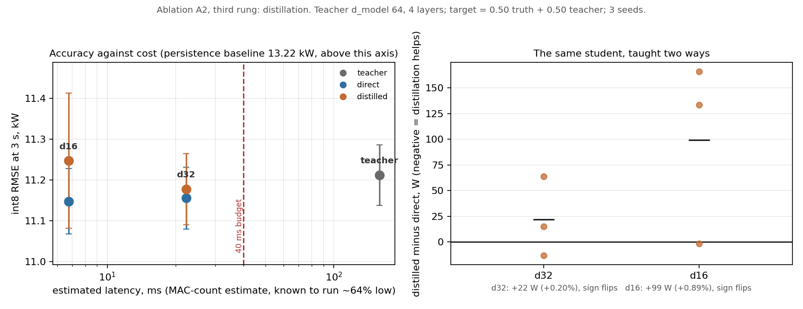

# Ablation A2, third rung: the distilled students

**Date:** 2026-09-02
**Script:** `scripts/run_distill.py`, figure by `scripts/plot_distill.py`
**Data:** `docs/a2-distillation.json`, `docs/a2-distillation.csv`
**Measured on the laptop.** No board is involved in this rung; the costs below
are the same arithmetic cost model used since week 1, and the latency column is
an estimate, not a measurement.

Spec 6.3 lists ablation A2 as float32 to int8 to distilled student, and 7.2
says what the third rung means: train the unconstrained Transformer offline,
then distil into whatever fits the G1 budget. Rungs one and two were measured
in week 6. This is the one that was left.

**Result: the rung is null, and the reason it is null is more useful than the
rung itself.**

---

## 1. The question, narrowly

The deployed forecaster is already sized to the G1 budget and trained directly
on the data, so "does a big model beat a small one" is not the question and
would not be interesting. The question is whether a budget-sized model *taught
by* a big one beats the same budget-sized model taught by the data alone. Same
architecture, same seeds, same windows, one difference.

Two students: `d32`, which is the configuration G1 sized and week 6 deployed,
and `d16`, half its width, included because a Pareto front needs more than one
point on it. The teacher is d_model 64 across 4 layers, deliberately over
budget -- if it fitted there would be nothing to distil into.

### No distillation loss was written, and that is exact rather than lazy

For a squared-error objective, with `a + b = 1`,

```
a*||s - y||^2 + b*||s - t||^2  =  ||s - (a*y + b*t)||^2 + c(y, t)
```

and the leftover term does not involve the student's output. Training on the
blended target is therefore *exactly* the blended distillation loss, with
identical gradients, not an approximation of it. So the students are trained by
the same `fit_transformer` every other arm uses, with their targets replaced,
which keeps every arm on one training path. `tests/forecast/test_distill_target.py`
pins the identity.

The blend is 0.50 truth and 0.50 teacher. The teacher sees training windows
only; it never touches validation.

## 2. The control arm reproduces week 6 exactly

Before any of the numbers below mean anything, the `d32-direct` arm has to be
the model week 6 already measured, because this script builds its dataset and
trains its arms independently of `run_a2.py`.

| | week 6 (`a2-quantisation.json`) | this run |
|---|---|---|
| float32 RMSE | 11051.066655184704 W | **11051.066655184704 W** |
| int8 RMSE | 11155.723982268457 W | **11155.723982268457 W** |
| deployed bytes | 20,664 | **20,664** |

Bit for bit, on all three. The control arm is provably the same model, so the
comparisons that follow are against a known quantity.

## 3. Distillation does not help



*Left: accuracy against cost, one column per architecture. Direct and distilled
sit at the same x because they are the same architecture and cost the same; the
grey line joins each pair, so the vertical gap is the entire effect. Right: the
same comparison paired by seed.*

Paired by seed, int8, negative would mean distillation helped:

| Student | mean | per seed | verdict |
|---|---|---|---|
| d32 | **+21.9 W (+0.20%)** | −13, +64, +15 | sign flips |
| d16 | **+99.2 W (+0.89%)** | +134, +166, −2 | sign flips |

Both means are the wrong side of zero and neither sign is consistent across
three seeds. By the convention this project used to call ablation A3 null --
an interval that spans zero and a sign that does not hold across seeds -- **A2's
third rung is null**.

A 2-epoch pilot run pointed the other way, at −0.44% and −0.81%. It was not
reported, and this is why: at a sixth of the training and one seed it was
measuring which arm had got further, not which arm ends up better.

## 4. Why it is null: the teacher has nothing to teach

This is the part worth keeping.

| Arm | int8 RMSE | vs persistence | footprint | est. latency | params |
|---|---|---|---|---|---|
| teacher, d64 x 4 | 11.212 kW | 15.2% | 141.7 KB | 158.85 ms | 136,414 |
| d32 direct | 11.156 kW | 15.6% | 20.2 KB | 22.28 ms | 18,366 |
| d32 distilled | 11.178 kW | 15.4% | 20.2 KB | 22.28 ms | 18,366 |
| **d16 direct** | **11.148 kW** | **15.7%** | **6.1 KB** | **6.75 ms** | **5,102** |
| d16 distilled | 11.247 kW | 14.9% | 6.1 KB | 6.75 ms | 5,102 |

**The teacher is not better than its students.** At 26.7 times the parameters
and 23.1 times the footprint of the smallest student it lands 64.3 W *worse* on
int8 RMSE. Distillation transfers what the teacher knows that the student does
not, and here that set is empty. The null result is therefore not a failure of
the method; it is the method correctly reporting that there was nothing to
move.

The differences in that table should not be over-read in the other direction
either. Seed-to-seed spread is 43 to 165 W, so `d16 direct` finishing ahead of
`d32 direct` by 8 W is noise, not a discovery. What survives is the flatness,
not the ordering.

## 5. What the front actually says, which is claim C4

All five arms fall inside **99.2 W**, or 0.89% of each other. Three comparisons
put that number in scale:

- It is **smaller than the cost of quantising**, which week 6 measured at 0.95%.
  The entire architecture sweep, from 5,102 parameters to 136,414, moves the
  error less than converting the same model from float32 to int8 does.
- The gap from the best arm to persistence is **2,070.8 W**. So the whole
  sweep moves **4.8%** of the distance that the forecaster's existence buys.
- Every arm clears G4's 10% threshold, at 14.9 to 15.7%.

This is the same shape the model ladder found in week 4 and the DP optimum
found in week 7, arriving a third time from a new direction: the useful signal
in this problem is captured early and cheaply, and capacity beyond that point
is spent on nothing. A ridge regression already reached 87% of the achievable
skill for 1.2% of the compute.

## 6. What this does and does not decide

It does **not** take the parked decision about what ships. That decision is
recorded in the spec's open-items table and depends on the outer-loop question.

What it adds is a cheaper option that was not on the table before. `d16` at
**6.1 KB and an estimated 6.75 ms** is indistinguishable from the deployed
`d32` at 20.2 KB and 22.28 ms, and from a teacher 23 times its size. If the
forecaster ships at all, nothing measured here justifies paying for `d32` over
`d16`.

Two cautions before that is acted on. The latency column is a MAC-count
estimate, and this project has already measured what those are worth: the
deployed encoder was estimated at 22.28 ms and timed on silicon at 36.46, so
the estimate ran 64% low. `d16`'s 6.75 ms is a ranking, not a latency, and it
would need timing on the board like every other deployed figure. And three
seeds is the convention rung one and two used, but it is thin for a null: it
establishes that the sign does not hold, not a tight bound on the effect.

## 7. Limitations

- Three seeds, not five. Enough to show the sign flips; not enough to bound the
  effect tightly. The SAC campaign used five, and its convention is the better
  one where a null is load-bearing.
- One blend weight, 0.50. A sweep over the blend might find a setting that
  helps, though with a teacher that is no better than the student there is no
  reason to expect one.
- One teacher shape. A genuinely better teacher -- more data, a different
  architecture, a longer schedule -- might have something to transfer. What is
  shown here is that scaling this architecture on this dataset does not produce
  one.
- Validation-set numbers throughout. The test split stays sealed. Weights are
  the final epoch's rather than the best epoch's, so no epoch is selected on
  the set being reported, which is the same convention rungs one and two used.
