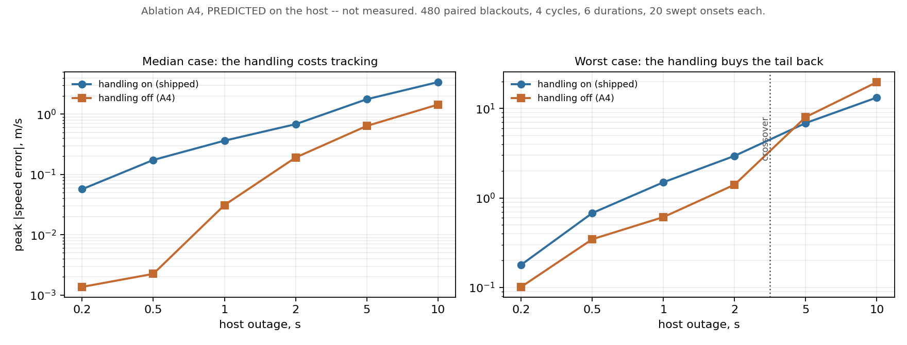

# Ablation A4, predicted before the hardware run

**Date:** 2026-09-02
**Script:** `scripts/predict_a4.py`
**Data:** `docs/week9-a4-prediction.json`
**Status: a prediction, not a measurement.** No board was attached. Nothing
here may be cited as a result.

Ablation A4 switches the deadline-miss handling off and asks what that costs in
control quality, which is the half of claim C5 that says "quantified
degradation". The measurement needs the board. This writes the answer down
first, so the hardware run is checked against a number that existed before it.

That order is the convention this project already runs on. The DP optimum
predicted ablation A3 null, with a reason, before SAC was trained; the
five-seed campaign then agreed. A prediction produced after the run would have
been worth nothing, and the same applies here.

---

## 1. What was simulated

The firmware's control task, not the host simulator's outer loop. The loop in
`predict_a4.py` mirrors `firmware/main/tasks.c` step for step, at the same
10 ms period, with the same two constants that define the limp path:
`STALE_LIMIT_STEPS` = 5 and `LIMP_RAMP_NM` = 10.

One detail decides whether the model is honest. When the host stops answering,
the control task keeps the **whole** state frame it last received. The speed
measurement goes stale, and so do the reference, the reference acceleration and
the grade -- so the feedforward is stale too, not only the feedback. Modelling
a stale `v_meas` alone would leave the feedforward tracking a reference the
controller could not actually see, and would understate the cost.

The two modes differ exactly as `#if FALLBACK_ENABLED` does:

| Mode | Behaviour during the outage |
|---|---|
| handling **on**, shipped | after 5 silent steps, torque ramps out at 10 Nm per step and the integrator is frozen |
| handling **off**, A4 | the PID keeps running on the frozen state frame, integrating against an error it cannot refresh |

480 paired blackouts: four cycles (UDDS, HWFET, US06, WLTC 3b), six outage
durations, 20 onsets swept across each cycle. The onset is swept rather than
placed once because a single onset can be chosen to flatter either mode -- an
outage during a cruise costs almost nothing, one during hard acceleration costs
a great deal.

Each blackout is simulated from a 15 s lead-in rather than from the start of
the cycle. Running 1800 s of WLTC to study three seconds of it costs about
seventy times what the question needs. The lead-in is not assumed to be enough:
the worst tracking error anywhere before any blackout is **0.017 m/s**, so the
loop is settled when the outage begins.

## 2. The prediction

Peak absolute speed error against the true reference, m/s, over the outage and
the 2 s after it.

| Outage | on, median | off, median | on, worst | off, worst |
|---|---|---|---|---|
| 0.2 s | 0.057 | **0.001** | 0.179 | **0.101** |
| 0.5 s | 0.174 | **0.002** | 0.679 | **0.346** |
| 1.0 s | 0.363 | **0.031** | 1.499 | **0.612** |
| 2.0 s | 0.681 | **0.190** | 2.954 | **1.408** |
| 5.0 s | 1.764 | **0.636** | **6.881** | 8.024 |
| 10.0 s | 3.392 | **1.437** | **13.265** | 19.705 |

*Left: the median case, where handling off tracks better at every duration.
Right: the worst case, where the two cross at 5 s. Log axes, because the
error spans four orders of magnitude across the durations swept. Drawn by
`scripts/plot_a4.py`.*

**The median and the worst case disagree, and that disagreement is the
finding.** By the median, switching the handling off tracks better at every
duration tried: holding the last command through a short outage is simply a
better guess than ramping torque to zero, because over a second or two the
reference has not moved far. By the worst case, that reverses at a **5 s**
outage, where holding a stale command produces a 19.7 m/s excursion against
limping's 13.3.

This is what a safety mechanism is supposed to look like. It spends tracking in
the ordinary case to bound the bad one. The firmware's own comment gives the
reason -- acting on an arbitrarily old speed measurement is worse than not
acting -- and the numbers say that reasoning holds in the tail, which is where
it was aimed, and costs something everywhere else, which is the price.

So A4 is predicted **not** to be null, and predicted to point the opposite way
from the obvious reading. Turning the handling off should *improve* median
tracking. Reporting that as the handling being useless would be a
misreading of a mechanism that was never there to improve tracking.

## 3. What the prediction says is not affected

Peak battery current is the same in both modes to within 0.3 A -- 158.9 A
against 159.2 A at the worst -- across every duration. The electrical stress
argument does not separate the two, so it should not be used to. The difference
between them is tracking excursion and the recovery transient, and nothing
else.

The recovery transient is the handling's second cost. After limping to zero the
loop has to catch up, and its peak recovery torque saturates at 250 Nm for
outages of 1 s and longer, where the ablation stays at 169 Nm. Limping makes
the return harder than the outage.

## 4. What would falsify this

Stated now, so the hardware run can settle it rather than be interpreted
against it afterwards:

- If the measured peak error with handling off is **larger** than with handling
  on at a 1 s outage, the prediction is wrong. The hardware campaign injects
  exactly 1.0 s of host silence, which is the row this turns on: predicted
  0.031 m/s off against 0.363 m/s on, a factor of twelve.
- If `ctrl_late` moves off zero in either build, the loop is missing its own
  deadline and every comparison above is measuring something else.
- The absolute errors are optimistic and should not be quoted. The feedforward
  is computed from the same vehicle the plant simulates, so the nominal model
  is exact and the feedback term has less to do than it would on a vehicle
  (`src/evpil/control/sim.py` says the same thing about its own numbers). The
  ON-against-OFF comparison is what carries over; the magnitudes are a floor.
- The plant is deterministic and noiseless here. The hardware loop has 25 us of
  jitter and a real link, so the measured spread should be wider than the
  swept-onset spread above, not narrower.
