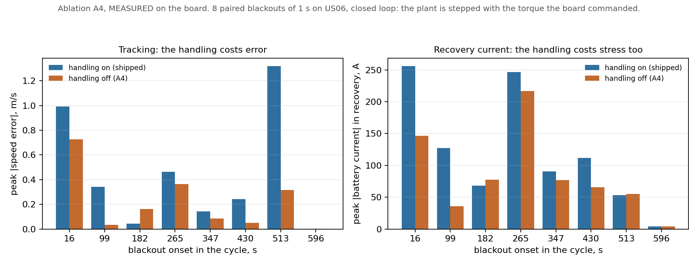
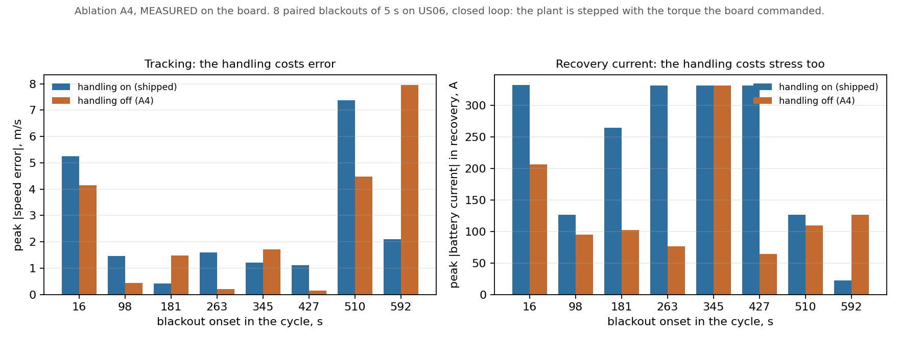

# Ablation A4, measured on hardware

**Date:** 2026-09-02
**Firmware:** `firmware/main/tasks.c`, built four ways
**Scripts:** `scripts/run_fallback.py` (counters),
`scripts/run_a4_closedloop.py` (control quality)
**Data:** `docs/week9-a4.json`, `docs/week9-a4-baseline.json`,
`docs/week9-a4-closed-on.json`, `docs/week9-a4-closed-off.json`,
`docs/week9-a4-closed-on-5s.json`, `docs/week9-a4-closed-off-5s.json`
**Prediction it is scored against:** `docs/week9-a4-prediction.md`

The board arrived. Ablation A4 has now been run, and so has its baseline.

Two campaigns, because the first one could not answer the question. The
counter campaign confirms that the handling is compiled out and that the limp
ramp runs on silicon, and every expectation written before the run holds. It
cannot say what the handling costs in control quality, because the harness it
inherits from G3 never closes the loop. Section 4 is that finding. Section 5 is
the closed-loop campaign written to replace it, and the answer.

Headline, at a 1.0 s outage: the prediction called the direction correctly and
the size badly. Switching the handling off tracks better, 0.125 m/s against
0.292 m/s at the median, a factor of 2.3 where a factor of twelve was
predicted. The prediction's claim that the two modes cannot be separated on
battery current is refuted, and section 6 shows the defect in its own code that
produced it.

Headline, at a 5 s outage: the crossover the handling exists for is real and
lands close to where the prediction put it. The worst case goes to the
handling, 7.386 m/s against 7.949 m/s, predicted 6.881 against 8.024. Section 7.
A4 is therefore not null, and it is not a verdict against the limp path
either.

---

## 1. What was run

Both halves were flashed and measured in one session, on one board, through
one harness. That pairing is new. Week 7 measured the handling-on build before
`RECOVERY_WINDOW_S` existed, so `docs/week7-fallback.json` carries no record of
what the torque command did after the outage closed, which is the window the
prediction cares about most.

| | handling on | handling off (A4) |
|---|---|---|
| Build | `-DFAULT_INJECT=1 -DFALLBACK_ENABLED=1` | `-DFAULT_INJECT=1 -DFALLBACK_ENABLED=0` |
| `evpil_fw.bin` | 0x32e20 | 0x32d90 |
| Output | `docs/week9-a4-baseline.json` | `docs/week9-a4.json` |

The ablation build is 144 bytes smaller. Two guarded branches leaving the image
is what that difference is.

One trap is worth recording because it nearly cost a run. `FALLBACK_ENABLED`
persists in `firmware/build/CMakeCache.txt`, and `main/CMakeLists.txt` tests it
with `if(DEFINED ...)`, which a cache entry satisfies. Rebuilding the baseline
with `-DFAULT_INJECT=1` alone therefore leaves the ablation switched on, and
the build log is the only place that says so. The baseline here passes
`-DFALLBACK_ENABLED=1` explicitly, and the build log line
`evpil: FALLBACK_ENABLED=1` was checked before it was flashed.

Board: ESP32-S3 QFN56 rev v0.2, MAC `1c:db:d4:46:24:e8`, on
`/dev/cu.usbmodem1101`. Same part as the week 7 and week 8 campaigns, on a
different USB enumeration.

## 2. The counters

Deltas over a 50 s run, 1.0 s of host silence injected at 8.0 s, an outer-loop
stall at 20.0 s and an inference overrun at 40.0 s.

| Counter | Guarded? | Expected under A4 | On | Off | |
|---|---|---|---|---|---|
| `ctrl_fallback_steps` | yes | exactly 0 | 180 | **0** | ok |
| `limp_steps` | yes | exactly 0 | 95 | **0** | ok |
| `ems_fallback_steps` | no | >= 5 | 20 | 20 | ok |
| `infer_deadline_misses` | no | >= 5 | 20 | 20 | ok |
| `stale_steps` | no | >= 50 | 102 | 102 | ok |
| `ctrl_late` | no | exactly 0 both modes | 0 | **0** | ok |
| `loop_count` | | | 4950 | 4950 | |

Every expectation holds. The two guarded counters read zero in the ablation and
move in the baseline, which is the ablation doing its job rather than the
firmware failing, and the pre-registered table is what lets those two readings
be told apart.

`ctrl_late` staying at zero in both builds settles the second of the
prediction's three falsification conditions. The fallback path does not cost
the control loop its own deadline, and neither does removing it, so the
comparison is between two loops that both met their timing.

Against week 7, `limp_steps` came in at 95 rather than 96 and `stale_steps` at
102 rather than 101. One step of jitter in where a 1.0 s host silence lands
against a 10 ms control period. Nothing turns on it.

## 3. What the torque command did

The mechanism the ablation removes is visible in the actuation stream, and it
is visible in the direction the firmware comment claims.

| | handling on | handling off (A4) |
|---|---|---|
| Command entering the outage | 226.07 Nm | 226.09 Nm |
| Command at the end of the 1.0 s window | **0.00 Nm** | **226.07 Nm** |
| Range across the window | 226.07 to 0.00 | 226.07 to 226.18 |

With the handling in, torque ramps out at 10 Nm per step and reaches zero
inside the window. With it compiled out, the loop holds its last command flat
for the whole second. That is the ablation working on silicon, and it is the
first direct confirmation that `LIMP_RAMP_NM` behaves on the board the way
`predict_a4.py` models it on the host.

## 4. The open loop cannot answer the question, and did not

The prediction's sharpest claim about the handling's cost is that it makes the
return harder: after limping to zero the loop has to catch up. Over the 2 s
after the host started answering, the two builds measured this way recover
identically, to within 0.11 Nm of peak, and the handling-on build climbs from
0 Nm back to 226 Nm in a single 10 ms step with no overshoot.

That is not a refutation. It is the harness reporting on a loop that was never
closed.

`scripts/run_g3.py:plant_state` is a closed-form function of the step index,
and `run_fallback.py` feeds it straight into the state frame, so the torque the
device commands never reaches the plant that answers it. Two consequences
follow:

1. **No tracking error can accumulate.** Torque going to zero for a second does
   not slow the simulated vehicle, because nothing connects the two. When the
   host answers again the speed is exactly where the closed form says it should
   be, so there is nothing to catch up to.
2. **The step index freezes during the silence.** `step` advances only when the
   host sends a frame, so the reference pauses along with the outage instead of
   running on ahead of the controller.

The G3 note explains why `plant_state` is closed-form, and the reasoning was
right for G3: replaying a real trip would add host-side work that varies per
step and would appear in the timing as jitter the loop did not cause. A4 is a
control-quality measurement borrowing a link-timing harness, and the property
that made the harness good for the first purpose disqualifies it for the
second.

So sections 2 and 3 stand as measured, and the prediction's headline number is
not among the things they settle. `scripts/run_a4_closedloop.py` closes the
loop, and section 5 is what it found.

## 5. The loop closed, and the prediction scored

`scripts/run_a4_closedloop.py` runs the same blackout against the same two
builds, with the validated plant from `docs/g2-plant-validation.md` stepped by
the torque, regen blend, power limit and auxiliary derate the board just sent.
The reference is a drive cycle. The board keeps sending actuation at 100 Hz
through the outage, so the plant keeps moving and the cycle keeps running on,
which is what a vehicle does when its link drops.

Built with `FAULT_INJECT=0`, so the host blackout is the only fault. Eight
onsets swept across US06, 1.0 s of silence each, 15 s lead-in, 2 s recovery,
the same windows `predict_a4.py` uses. The onset is swept rather than placed
once for the reason the prediction gives: a single onset can be chosen to
flatter either mode. Worst pre-blackout error across all sixteen runs was
0.127 m/s, so the loop was settled before every blackout.

**Data:** `docs/week9-a4-closed-on.json`, `docs/week9-a4-closed-off.json`.

| Onset, s | v_ref, m/s | On, peak err | Off, peak err | On, I recovery | Off, I recovery |
|---|---|---|---|---|---|
| 16.0 | 14.44 | 0.992 | **0.725** | 255.7 | **146.8** |
| 98.9 | 29.83 | 0.343 | **0.034** | 127.0 | **35.6** |
| 181.7 | 24.64 | **0.043** | 0.164 | **68.5** | 77.5 |
| 264.6 | 27.77 | 0.463 | **0.364** | 246.7 | **216.6** |
| 347.4 | 29.70 | 0.142 | **0.086** | 90.6 | **77.2** |
| 430.3 | 30.52 | 0.242 | **0.051** | 111.8 | **66.0** |
| 513.1 | 4.76 | 1.318 | **0.315** | 53.5 | 55.3 |
| 596.0 | 0.00 | 0.0017 | 0.0017 | 4.4 | 4.4 |
| **median** | | 0.292 | **0.125** | 101.2 | **71.6** |
| **worst** | | 1.318 | **0.725** | 255.7 | **216.6** |

*Paired bars, same eight onsets against each build. Drawn by
`scripts/plot_a4_measured.py`. Its companion `scripts/plot_a4.py` draws the
prediction, in the same two colours.*

Six of the eight onsets go to the ablation, one to the handling, and the last
is a standstill where the vehicle is stopped and neither mode does anything.

**The prediction's direction holds.** Switching the deadline-miss handling off
tracks better at a 1.0 s outage: median peak error 0.125 m/s against
0.292 m/s. That settles the condition the prediction staked itself on, and it
settles it the way the prediction said, against the obvious reading. Holding
the last command through a short outage is a better guess than ramping torque
to zero.

**The magnitude does not.** Predicted, the gap at 1.0 s was a factor of twelve,
0.031 m/s off against 0.363 m/s on. Measured, it is a factor of 2.3. The
handling-on half came in close to prediction, 0.292 against 0.363. Almost all
of the error is in the other half: holding a stale command was predicted to
cost 0.031 m/s and cost 0.125 m/s, four times worse. A deterministic, noiseless
host plant flatters the mode whose whole strategy is to freeze and wait, and
degrades nothing for the mode that ramps to a fixed value. The prediction's own
last caveat said the measured spread should come out wider than the swept-onset
spread, and it did.

## 6. The prediction was wrong about current, for a reason in its own code

Section 3 of `docs/week9-a4-prediction.md` says peak battery current is the
same in both modes to within 0.3 A, 158.9 A against 159.2 A, and concludes that
the electrical stress argument does not separate them and should not be used
to. On the board they separate clearly: peak recovery current 101.2 A with the
handling on against 71.6 A with it off at the median, and 255.7 A against
216.6 A at the worst.

The disagreement is not simulation against hardware. It is a scoping defect in
the prediction, visible by reading it. `predict_a4.py` updates `peak_i_a` on
every step from `k_start`, so its statistic covers the lead-in as well as the
event. The lead-in is fifteen seconds of drive cycle, identical in both modes
by construction, and on an aggressive cycle it contains the largest currents in
the run. That the two modes came out 0.3 A apart is a measurement of the
lead-in, not of the blackout. The closed-loop numbers above are scoped to the
recovery window on purpose, and the harness says so where it does it.

The measured lead-in peaks bear this out: 155.5 A with the handling on against
155.7 A with it off, a 0.2 A gap on the segment where the two modes are doing
the same thing, which is the gap the prediction reported for the whole run.

So at a 1.0 s outage the handling costs tracking, and it costs recovery current
too. Both are supposed to be the price of bounding the tail. Section 7 goes and
tests the tail.

## 7. The tail, at a 5 s outage

The reason the handling is in the firmware is the worst case, and the
prediction puts the crossover at a 5 s outage. Same campaign, same eight
onsets, `--blackout-s 5.0`.

**Data:** `docs/week9-a4-closed-on-5s.json`,
`docs/week9-a4-closed-off-5s.json`. Worst pre-blackout error 0.283 m/s.

| Onset, s | v_ref, m/s | On, peak err | Off, peak err | On, I recovery | Off, I recovery |
|---|---|---|---|---|---|
| 16.0 | 14.44 | 5.247 | **4.158** | 332.4 | **206.5** |
| 98.3 | 30.27 | 1.461 | **0.442** | 127.0 | **95.2** |
| 180.6 | 25.01 | **0.411** | 1.480 | 264.8 | **102.1** |
| 262.9 | 27.85 | 1.602 | **0.210** | 332.2 | **76.9** |
| 345.2 | 30.14 | **1.220** | 1.714 | 332.0 | 332.0 |
| 427.4 | 30.83 | 1.109 | **0.149** | 332.2 | **64.5** |
| 509.7 | 11.34 | 7.386 | **4.473** | 126.8 | **110.0** |
| 592.0 | 2.75 | **2.105** | 7.949 | **22.0** | 126.6 |
| **median** | | **1.532** | 1.597 | 298.4 | **106.0** |
| **worst** | | **7.386** | 7.949 | 332.4 | 332.0 |

**The crossover is real and it lands where the prediction put it.** At 5 s the
worst case goes to the handling, 7.386 m/s against 7.949 m/s. Predicted, that
row read 6.881 against 8.024. Both the direction and the size come out close,
which is the prediction's strongest showing anywhere in this ablation.

The mechanism is legible in one row. At onset 592.0 the cycle is winding down
to a stop, v_ref 2.75 m/s and falling. Holding a stale command there means
driving 5 s of torque into a vehicle that should be braking, and the ablation
records a 7.949 m/s excursion against the handling's 2.105. That single row is
the whole safety argument: not that limping tracks well, but that it fails
small when holding fails large.

**The median advantage has already gone by 5 s, earlier than predicted.**
Measured, the two modes are a near tie at the median, 1.532 on against 1.597
off, a 4% gap. Predicted, the median at 5 s was still a wide win for the
ablation, 1.764 against 0.636. So the ordinary-case cost of the handling, real
and reproducible at 1.0 s, has been paid back by 5 s rather than persisting to
10 s as the prediction has it. Per onset the ablation still wins five of eight;
what changed is that the three it loses, it loses badly.

Recovery current goes the other way and goes there hard. At the median the
handling draws 298.4 A against 106.0 A, and it saturates at 332 A on four of
the eight onsets. Ramping torque to zero for five seconds and then catching up
is expensive, and at this duration that cost is the handling's largest.

## 8. Where A4 stands

| Question | Status |
|---|---|
| Do the guarded branches leave the image? | **Measured.** 144 bytes, both counters zero |
| Does the limp ramp run on the board? | **Measured.** 226 Nm to 0.00 Nm across the window |
| Does either build miss its own deadline? | **Measured.** `ctrl_late` 0 in all six campaigns |
| Tracking cost at a 1.0 s outage | **Measured.** 0.292 on against 0.125 off, median |
| Recovery current at a 1.0 s outage | **Measured.** 101.2 on against 71.6 off, median |
| Does the handling buy the tail back? | **Measured.** Yes at 5 s, worst case 7.386 on against 7.949 off |
| Where exactly the crossover sits | **Not measured.** Somewhere between 1 and 5 s; only two durations were run |

Claim C5 is carried by measurement in both halves. A miss is detected, handled
and counted rather than silently absorbed, and the degradation is quantified at
two outage durations, including the one where the handling stops being a cost
and starts being the reason it exists.

## 9. What is left

Two durations is enough to show the crossover exists and not enough to locate
it. `--blackout-s` takes any value, so bracketing it is a matter of running 2 s
and 3 s, at about three minutes a build. Nobody should quote a crossover
duration from these two points.

The prediction's 10 s row is also untested, and its 0.2 s and 0.5 s rows are
below anything measured here.
